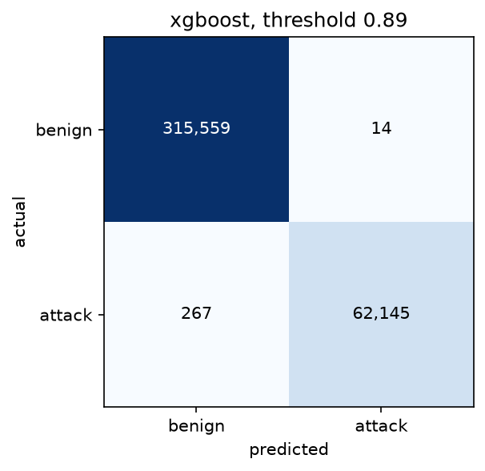
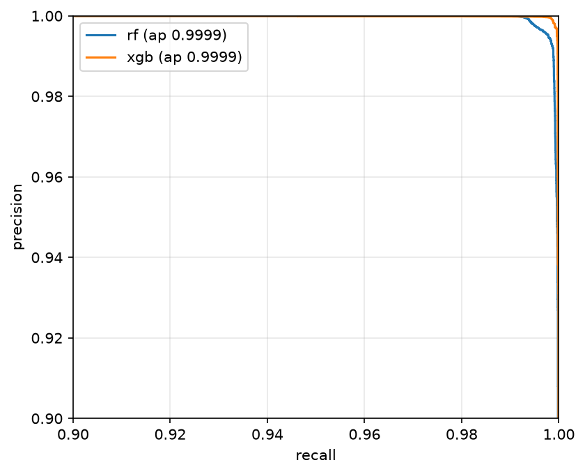

# ML intrusion detection on CIC-IDS2017

## Goal

Train and evaluate classifiers that label network flows as benign or attack on CIC-IDS2017, with an evaluation designed to avoid the usual inflated scores (duplicate rows, conflicting labels, shuffled splits), and a threshold chosen from an explicit alert-cost argument.

## What this shows

- Cleaning a public intrusion dataset and recording every removal: 8 constant columns and 1 duplicate column dropped, 2,867 inf/NaN rows, 6,666 rows whose identical feature vectors carry conflicting labels, and 301,806 exact duplicates removed. 2,519,404 of 2,830,743 rows remain.
- Duplicates were uneven across classes (PortScan 42.9%, SSH-Patator 45.4%, DoS Hulk 25.2%, benign 7.8%), so a naive split would have inflated scores.
- A blocked split (blocks of 1,000 consecutive rows per file, 30% of blocks held out, seed 42) compared with a plain random split. After cleaning, the two gave very similar scores, so I report that duplicates were not driving the result.
- Three models on the same split: logistic regression baseline, random forest, XGBoost.
- Stress tests: block size sensitivity and leave-one-attack-type-out.
- Threshold selection on one half of the held-out blocks and reporting on the other half.

## What this does not show

- It is not a general intrusion detector. Train and test come from the same lab capture, so this measures known attack types in one network.
- Unseen attack types were detected from 0% to 97% of the time in the leave-one-out test (Bot 0%, PortScan 0.4%, SSH-Patator 1%, slowloris 97%).
- The benign traffic is synthetic. Results say nothing about real enterprise traffic.
- No timestamps are in these CSVs. The blocked split assumes row order follows capture order.
- It is not a deployable system: no streaming, no feature extraction from packets, no latency or drift testing.

## Setup

1. Python 3.14 virtual environment, then `pip install -r requirements.txt`.
2. Download MachineLearningCSV.zip only (not the pcaps) from the official CIC-IDS2017 page (University of New Brunswick, Canadian Institute for Cybersecurity). Extract to `C:\ml-data\cic-ids2017`. The data is not in this repo.
3. Paths in the scripts are Windows paths under `C:\ml-data`; edit them for your machine.
4. Run in order: `inspect_data.py`, `check_data.py`, `clean_data.py`, `check_order.py`, `split_data.py`, `baseline_lr.py`, `trees.py`, `stress.py`, `threshold.py`, `final_eval.py`.

## Results

Binary task (benign vs any attack), blocked split, default threshold 0.5, 757,247 test flows:

| model | precision | recall | F1 | PR-AUC |
|---|---|---|---|---|
| logistic regression | 0.8835 | 0.8789 | 0.8812 | 0.9532 |
| random forest | 0.9993 | 0.9930 | 0.9961 | 0.9999 |
| XGBoost | 0.9991 | 0.9984 | 0.9987 | 0.9999 |

Random split gave XGBoost F1 0.9984 and logistic regression F1 0.8708, so the blocked split did not lower scores here.

Block size sensitivity (XGBoost F1): 0.9986 at 100 rows, 0.9987 at 1,000, 0.9971 at 10,000, 0.9626 at 50,000.

Threshold choice (XGBoost, thresholds picked on a validation half of test blocks, reported on the other half), at an assumed attack rate of 1 in 10,000:

| setting | threshold | recall | false alerts per million flows | precision |
|---|---|---|---|---|
| default | 0.50 | 0.9986 | 165 | 0.377 |
| missed attack costs 10 false alerts | 0.93 | 0.9918 | 35 | 0.740 |
| missed attack costs 100 false alerts | 0.89 | 0.9957 | 44 | 0.692 |
| missed attack costs 1000 false alerts | 0.59 | 0.9984 | 108 | 0.481 |

Final evaluation at threshold 0.89 on the final half (377,985 flows, 62,412 attacks): 14 false positives, 267 missed attacks, precision 0.9998 and recall 0.9957 on this test set (attacks are about 16% of it). See `confusion_matrix.png` and `pr_curve.png`.

Recall by attack type at 0.89: DDoS 0.999, DoS Hulk 0.998, DoS GoldenEye 0.991, DoS slowloris 0.997, PortScan 0.995, FTP-Patator 1.000, SSH-Patator 0.994, Web Brute Force 0.997, Bot 0.772, Infiltration 0.750 (8 flows), Web XSS 0.364 (11 flows), Heartbleed 0.000 (11 flows, none in training).

Confusion Matrix

PR Curve

## Limitations

- Same-capture evaluation (see above). The leave-one-out numbers are the more honest guide to new attacks.
- The attack rate (1 in 10,000) and the cost ratios (10, 100, 1000) are my assumptions, not measurements. The chosen threshold depends on them.
- Removing exact duplicates is a trade-off, because real traffic does repeat. I chose it to avoid inflated scores.
- Rows with conflicting labels were removed, so the hardest ambiguous flows are not in the evaluation. The dataset has documented labelling errors.
- Rare classes (Heartbleed 11 rows, Infiltration 36, SQL injection 21) are too small for reliable per-class numbers. They stay inside the "attack" class.
- Logistic regression did not fully converge at 300 iterations, so the baseline is slightly under-trained.
- The random forest was constrained for speed (depth 20, 30% of rows per tree), so its weaker result says little about forests in general.
- Models lean heavily on a few packet-size features (Bwd Packet Length Std, Average Packet Size, Bwd Header Length), which may be artefacts of how the lab traffic was generated.

## Data licence

CIC-IDS2017 is for research use. Cite: Sharafaldin, Lashkari, Ghorbani, "Toward Generating a New Intrusion Detection Dataset and Intrusion Traffic Characterization", ICISSP 2018. Do not commit the data.

## How I used AI assistance

I used Claude to plan the work phase by phase, draft the scripts, and explain choices. I ran every script myself and the results above are from my runs.
